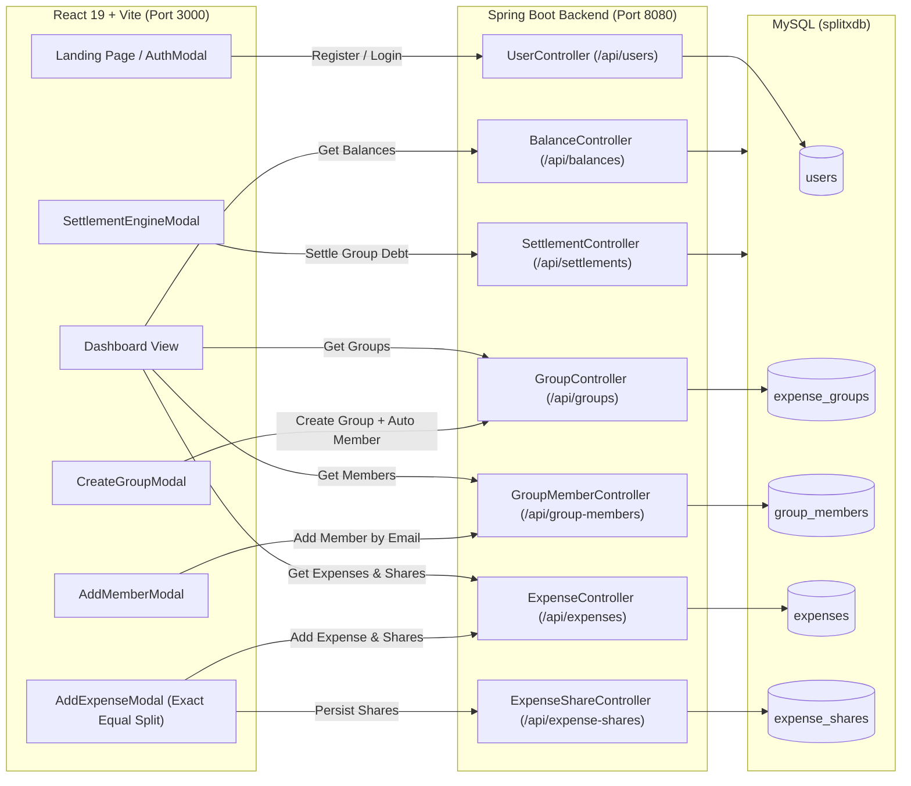
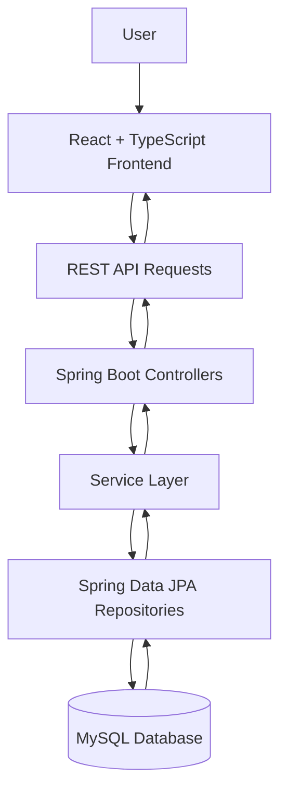
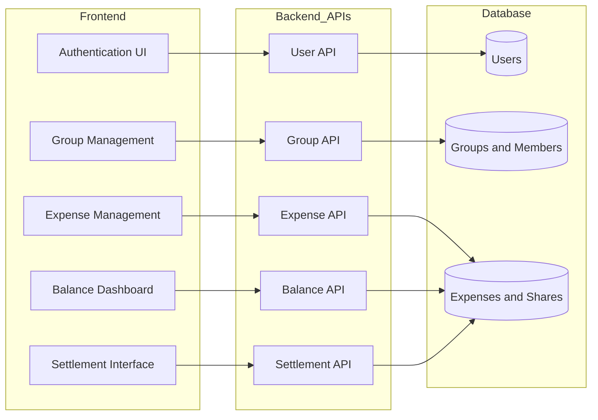
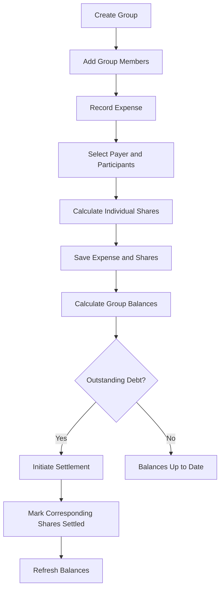

# SplitX Full-Stack Integration Walkthrough

## Summary of Completed Work

SplitX has been fully connected end-to-end between the **Spring Boot 4 / Java 25 backend (MySQL persistence)** and the **React 19 / Vite / TypeScript frontend**, preserving the design system and aesthetic while removing mock data bottlenecks.

---

## 1. Architecture & Integration Overview



---

# SplitX — Full-Stack Integration Walkthrough

## Overview

SplitX is a full-stack expense-sharing application built with React, Spring Boot, and MySQL. It helps users organize group expenses, record shared costs, review balances, and manage settlements.

The frontend communicates with the backend through REST APIs. The backend handles application logic and persists data using Spring Data JPA and MySQL.

## Tech Stack

| Layer | Technologies |
|---|---|
| Frontend | React, TypeScript, Vite |
| Backend | Java, Spring Boot, Spring Data JPA, Hibernate |
| Database | MySQL |
| Build tools | npm, Maven |
| API documentation | Swagger / OpenAPI |

## 1. Architecture

The application follows a client-server architecture. Requests from the frontend pass through REST controllers and the service layer before repository operations access the database.



## 2. Core Features

### User Management
- User registration and login.
- User lookup by ID or email.
- User information returned through response DTOs.

**Security note:** The described login flow stores user information in browser local storage. This is client-side state management, not token-based authentication.

### Group Management
- Create expense groups.
- Automatically add the group creator as a member.
- Retrieve groups associated with a user.
- Add members to groups using their email addresses.

### Expense Management
- Record expenses within groups.
- Select the payer and participating members.
- Divide expenses equally while accounting for rounding differences.
- Persist expense shares in the database.

### Balances and Settlements
- Retrieve group balances.
- Identify outstanding amounts between members.
- Mark corresponding expense shares as settled.
- Refresh dashboard data after settlement actions.

## 3. Feature Integration

The following diagram summarizes the main frontend-to-backend feature connections described for SplitX.



## 4. Frontend Integration

The frontend uses a centralized API client to communicate with the backend.

Key components include:

- **Authentication:** registration and login forms.
- **Dashboard:** group overview, expenses, balances, and navigation.
- **Group management:** create groups and add members.
- **Expense management:** record expenses and configure participants.
- **Settlement interface:** view outstanding debts and mark them as paid.

The dashboard is intended to display data returned by the backend. Verify each action in the running application before describing it as fully integrated, since a successful build alone does not establish end-to-end behavior.

## 5. Backend API Modules

| Module | Base path | Purpose |
|---|---|---|
| Users | `/api/users` | Registration, login, and user lookup |
| Groups | `/api/groups` | Group creation and retrieval |
| Group members | `/api/group-members` | Membership management |
| Expenses | `/api/expenses` | Expense management |
| Expense shares | `/api/expense-shares` | Individual expense shares |
| Balances | `/api/balances` | Balance calculations |
| Settlements | `/api/settlements` | Settlement operations |

Refer to Swagger UI for the available endpoints and request formats, if enabled in the current configuration.

## 6. Expense Lifecycle

This diagram illustrates the intended expense-sharing workflow.



This is a conceptual workflow based on the described features. Confirm the behavior against the current code and test data before treating every step as verified.

## 7. Running Locally

### Prerequisites

- Java version compatible with the project configuration.
- Node.js and npm.
- MySQL.
- Git.

### Step 1: Configure the database

Create the database in MySQL:

```sql
CREATE DATABASE splitxdb;
```

Configure the database URL, username, and password in `src/main/resources/application.properties`.

Use your own local credentials. Never commit real passwords, API keys, or other secrets.

### Step 2: Start the backend

From the project root on Windows:

```powershell
.\mvnw.cmd spring-boot:run
```

Backend URL: `http://localhost:8080`

Swagger UI, if configured: `http://localhost:8080/swagger-ui/index.html`

### Step 3: Start the frontend

Open a separate terminal:

```powershell
cd frontend
npm install
npm run dev
```

Open the local URL printed by Vite. The development port depends on the Vite configuration.

Ensure the frontend API base URL points to the running backend. Refer to `frontend/.env.example` for the expected environment-variable configuration.

## 8. Build Verification

The original development walkthrough reported these checks:

- Frontend TypeScript check: passed.
- Frontend production build: successful.
- Backend test compilation: successful.
- Backend packaging with tests skipped: successful.

These are reported results from the original walkthrough, not independently re-run checks. Successful compilation and packaging do not, by themselves, guarantee that every feature passes end-to-end tests.

## 9. Security Considerations

Before using SplitX with real users:

- Store passwords using a secure password-hashing algorithm such as BCrypt.
- Do not store plaintext passwords or support plaintext password fallbacks.
- Protect API endpoints with appropriate authentication and authorization.
- Validate group membership and resource ownership on the backend.
- Keep database credentials and API secrets out of version control.
- Do not treat browser local storage as proof of authentication.

JWT-based authentication should only be documented as implemented after tokens are issued, validated, and enforced on protected API requests.

## 10. Potential Improvements

- Implement secure authentication and authorization.
- Add automated backend and frontend tests.
- Improve API error handling and validation.
- Add deployment configuration and environment-specific settings.
- Document API contracts and database relationships.

---

**Project:** SplitX — Smart Expense Sharing

**Purpose:** Simplify group expenses, balance tracking, and debt settlement.
